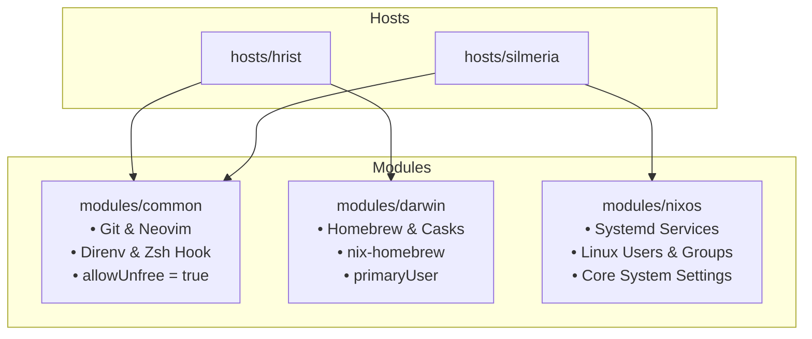

# nix-server

[](https://github.com/NixOS/nixpkgs/tree/nixos-26.05)
[](https://github.com/nix-darwin/nix-darwin/tree/nix-darwin-26.05)
[](https://github.com/nlewo/comin)
[](LICENSE)

This README is the **single source of truth** for building, operating, modifying, and validating this flake, for humans and AI agents alike. It replaces the former `guidelines.md` (merged and deleted; the section mapping is in the commit that did the merge). The only exempt manuals are the hardware references under `docs/`.

---

## 0 Read First

- **`main` is live production.** `silmeria` runs [Comin](https://github.com/nlewo/comin), which polls this repository and automatically builds + switches its system on every push to `main`. A broken evaluation on `main` can take down a working server (Comin fails safe and keeps the previous generation, but still). **Validate before you push, never push unverified work.**
- **Two platforms are managed from one flake:** `hrist` (`aarch64-darwin`, macOS) and `silmeria` (`x86_64-linux`, NixOS). A change that compiles for one host may break the other. Always validate **both** hosts.
- **Channel policy: exactly 6 direct inputs** — `nixpkgs`, `nixpkgs-darwin`, `nixpkgs-unstable`, `nix-darwin`, `nix-homebrew`, `comin`. Each host tracks the 26.05 release on the branch gated for *its* platform: `silmeria` on `nixos-26.05` (NixOS release tests) and `hrist` on `nixpkgs-26.05-darwin` (Darwin jobset, followed by `nix-darwin`). `nixpkgs-unstable` is a separate input consumed only via `specialArgs` as `pkgs-unstable` — it is **not** applied as an overlay and must not leak into the stable package set.
- **No secrets are stored in this repository.** Secrets live in host-local paths (e.g. `/etc/comin/access_token`, `/etc/nix-server/deploy-key`). Never commit tokens, keys, or credentials.
- **`scripts/verify-docs.sh`** machine-checks this file against the repo (see §7). Keep the tree in §2 and the host table in §1 in sync when layout or hosts change.

> Agents: this file's headings are stable anchors. Read §0 and the §13 Agent Checklist before every change, then only the sections your task needs (matrix below).

### Locked decisions — do not change, do not ask

These are deliberate, reviewed choices, not oversights. Agents must **not** change them,
and must **not** ask for permission to change them or raise them as findings. If a task
appears to require changing one, stop and say so instead of editing.

| Decision | Where | Why it stays |
| :--- | :--- | :--- |
| `homebrew.onActivation.cleanup = "zap"` | `modules/darwin/homebrew.nix` | **`zap` is how apps are uninstalled on `hrist`.** Deleting a cask from the `casks` list is the uninstall, and `zap` is what makes that real: it removes the app *and* its leftover state (preferences, application-support directories, launch agents, caches). Downgrading to `"uninstall"` or `"none"` turns every declarative removal into a half-removal and leaves orphaned state behind. Never lower it, and never "fix" a failed activation by weakening it — fix the cask instead (§10). |
| Minecraft `online-mode = false`, no whitelist | `modules/nixos/services/minecraft.nix` | The server is not exposed to the internet. `openFirewall = false` plus `networking.firewall.interfaces."tailscale0".allowedTCPPorts = [ 25565 ]` means port 25565 is reachable **only** from the tailnet, so **tailnet membership is the access control**. Mojang authentication and a `white-list` would be a second gate in front of a door only invited peers can open. Do not set `online-mode = true`, do not add `white-list`/`enforce-whitelist`, and do not report either as a security issue. |

Granting or revoking Minecraft access is a **Tailscale** operation (invite or remove the
peer / adjust tailnet ACLs), not a Minecraft one. Nothing in this repository needs to
change to add or remove a player.

### Task-to-section matrix

| Task | Read |
| :--- | :--- |
| Adding a cask / brew (hrist) | §1 + §6 |
| Adding a NixOS service | §3 + §7 |
| Adding a host | §3 (Adding a Host) + §7 |
| Adding a hardware/BIOS guide | §4 + §7 |
| Docs-only change | §11 |
| Updating flake inputs | §6 + §7 |
| Touching modules/common | §0 + §7 |
| Homebrew `cleanup`, Minecraft `online-mode`/whitelist | §0 Locked decisions — **do not change** |

## Table of Contents

- [0 Read First](#0-read-first)
- [1 Managed Hosts](#1-managed-hosts)
- [2 Architecture and Modular Layout](#2-architecture-and-modular-layout)
- [3 Module Authoring Conventions](#3-module-authoring-conventions)
- [4 Hardware and BIOS Guides](#4-hardware-and-bios-guides)
- [5 Bootstrap](#5-bootstrap)
- [6 Usage and Operations](#6-usage-and-operations)
- [7 Validation Workflow](#7-validation-workflow)
- [8 GitOps and Comin](#8-gitops-and-comin)
- [9 Code Style and Formatting](#9-code-style-and-formatting)
- [10 Hygiene Secrets and Footguns](#10-hygiene-secrets-and-footguns)
- [11 Commit Convention](#11-commit-convention)
- [12 Branching and PR Workflow](#12-branching-and-pr-workflow)
- [13 Agent Checklist](#13-agent-checklist)
- [14 Security Posture](#14-security-posture)
- [15 References](#15-references)

---

## 1 Managed Hosts

| Host | OS & Platform | Architecture | Role | Key Modules & Services |
| :--- | :--- | :--- | :--- | :--- |
| **`hrist`** | macOS (nix-darwin 26.05, stateVersion 5) | `aarch64-darwin` | Personal Workstation | `nix-darwin`, `nix-homebrew` (OrbStack, Chrome, Tailscale, etc.), Zsh direnv hook |
| **`silmeria`** | NixOS 26.05 (stateVersion 25.11) | `x86_64-linux` | Home Server | Comin GitOps (Private Repo Auth), daily flake.lock auto-update, OpenSSH, Tailscale VPN, Antigravity CLI (`agy`), Claude Code, Minecraft Server |

---

## 2 Architecture and Modular Layout

The repository is organized into a clean **3-Tier Structure**:
1. **`hosts/`**: Minimal, machine-specific entrypoints (hardware config, hostnames, module activations).
2. **`modules/`**: Reusable configuration layers divided into `common/` (cross-platform), `darwin/` (macOS-only), and `nixos/` (Linux-only).
3. **`flake.nix`**: Lightweight root orchestrator declaring the **6 direct inputs** (`nixpkgs`, `nixpkgs-darwin`, `nixpkgs-unstable`, `nix-darwin`, `nix-homebrew`, `comin`), mapping hosts, and passing `pkgs-unstable` via `specialArgs`. `flake.nix` is authoritative — update this list here if inputs change.

```text
nix-server/
├── .gitignore                         # ignored local artifacts (build outputs, agent tooling, macOS cruft)
├── LICENSE                            # MIT license
├── README.md                          # SINGLE SOURCE OF TRUTH (this file)
├── AGENTS.md                          # loader for AI agents -> README
├── flake.nix                          # Minimal root entrypoint (inputs, specialArgs & host mappings)
├── flake.lock                         # Pinned dependencies - keep committed, keep in sync
├── docs/                              # Hardware & BIOS guides (only exempt manuals)
│   ├── bios-setup-guide.md            # Dell OptiPlex 3000 BIOS settings (C-States, ASPM)
│   └── realtek-power-management.md    # r8169 / PCIe ASPM root-cause & tuning
├── scripts/
│   └── verify-docs.sh                 # Drift guards: tree vs find, 6 inputs, TOC anchors
├── hosts/
│   ├── hrist/                         # macOS Workstation (aarch64-darwin)
│   │   └── default.nix                # Imports modules/common & modules/darwin, sets hostname/stateVersion
│   └── silmeria/                      # NixOS Server (x86_64-linux)
│       ├── default.nix                # Imports modules/common & modules/nixos (+ hardware-configuration.nix), sets hostname/stateVersion, enables my.* toggles
│       └── hardware-configuration.nix # GENERATED by nixos-generate-config - DO NOT EDIT
└── modules/
    ├── common/                        # Shared cross-platform layer (Linux & macOS)
    │   ├── default.nix                # Aggregates common modules
    │   ├── nix.nix                    # allowUnfree (flakes live in modules/nixos/core/system.nix)
    │   ├── packages.nix               # Shared CLI tools (git, neovim, nixd, direnv, uv)
    │   └── shell.nix                  # Zsh configuration and direnv interactive hook
    ├── darwin/                        # macOS-specific layer
    │   ├── default.nix                # Aggregates darwin modules
    │   ├── homebrew.nix               # Homebrew taps, brews, casks; cleanup = "zap" (locked, §0)
    │   ├── system.nix                 # macOS daemon settings (nix.enable = false)
    │   └── users.nix                  # macOS primaryUser definition
    └── nixos/                         # NixOS-specific layer
        ├── default.nix                # Aggregates core and services
        ├── core/
        │   ├── system.nix             # System locales, timezones, flakes, and core tools (antigravity-cli, claude-code)
        │   └── users.nix              # Linux user account (mikaels): shell, groups, authorized keys
        └── services/
            ├── auto-update.nix        # Daily flake.lock refresh pushed to main for Comin to deploy
            ├── comin.nix              # GitOps deployment service (private repo token support; wired via comin.nixosModules.comin)
            ├── minecraft.nix          # Declarative PaperMC server; offline-mode, tailnet-only (locked, §0)
            ├── openssh.nix            # SSH daemon configuration & firewall rules
            └── tailscale.nix          # Mesh VPN configuration
```

Module separation strategy:



* **Shared (`modules/common/`)**: Developer tools (`neovim`, `git`, `nixd`, `direnv`, `uv`) and `allowUnfree = true`. Flakes (`nix-command`, `flakes`) are enabled only on NixOS via `modules/nixos/core/system.nix`; macOS inherits them from the Determinate installer.
* **macOS (`modules/darwin/`)**: GUI applications managed via Homebrew (Chrome, Obsidian, OrbStack, Discord, Tailscale, etc.), `nix-homebrew` integration, and Determinate daemon compatibility (`nix.enable = false`).
* **NixOS (`modules/nixos/`)**: Systemd services (`comin` with optional private repo access token, `auto-update`, `openssh`, `minecraft`, `tailscale`), Linux account `mikaels` in `wheel` and `networkmanager` with `zsh` as login shell, `antigravity-cli` and `claude-code` (sourced explicitly via `pkgs-unstable` `specialArgs`), automatic store GC/optimise, and in-tree `r8169` / PCIe ASPM power management overrides.

### Rules of Placement

| Concern | Goes in |
| :--- | :--- |
| Machine-specific (hostname, hardware, host-only tweaks) | `hosts/<host>/` |
| Works on macOS **and** Linux | `modules/common/` |
| macOS-only | `modules/darwin/` |
| Linux-only | `modules/nixos/` |
| A new NixOS service | `modules/nixos/services/<name>.nix` |

- Every layer directory has a `default.nix` that lists its children via `imports = [ ... ];`. When you add a module, **register it in the parent `default.nix`**.
- Keep hosts thin: hosts enable features, they do not re-implement them. `hosts/silmeria/default.nix` is the model — it only imports `hardware-configuration.nix`, the two module layers, sets hostname/boot/hardware specifics, and flips `my.*.enable = true;` toggles.
- `hardware-configuration.nix` is machine-generated. Make changes in the host `default.nix`, not there.

---

## 3 Module Authoring Conventions

NixOS service modules follow the **`my.*` options pattern** used throughout `modules/nixos/`:

```nix
{ config, lib, pkgs, ... }:

let
  cfg = config.my.services.<name>;
in
{
  options.my.services.<name> = {
    enable = lib.mkEnableOption "human-readable description";
  };

  config = lib.mkIf cfg.enable {
    # implementation here
  };
}
```

- Expose an `enable` option via `lib.mkEnableOption` and guard all `config` with `lib.mkIf cfg.enable`.
- Use `options.my.core.*` for core/system concerns and `options.my.services.*` for deployable services (see `core/system.nix`, `services/comin.nix`).
- Enable the feature from the host with `my.services.<name>.enable = true;` — never import it and assume it activates.
- When a module needs a package that only exists in unstable, take `pkgs-unstable` as a function argument (it is passed via `specialArgs` for every host; see `flake.nix`) and reference `pkgs-unstable.<pkg>`. See `core/system.nix`.
- Use `lib.mkDefault` for sane defaults so hosts can override; use plain assignment when the value is the deliberate default.

### Adding a NixOS Service

1. Create `modules/nixos/services/<name>.nix` following the pattern above.
2. Register it in `modules/nixos/default.nix` (imports).
3. Flip `my.services.<name>.enable = true;` in `hosts/silmeria/default.nix`.
4. Dry-run both hosts (§7) and run `nix fmt`.

### Adding a Host

To add a new machine to this repository:

1. Create a directory under `hosts/<hostname>/` with a `default.nix` importing `../../modules/common` and either `../../modules/darwin` or `../../modules/nixos`.
2. Add the host entry to `flake.nix` under `darwinConfigurations` or `nixosConfigurations`, passing `pkgs-unstable` via `specialArgs`. A new darwin host must also be wired to the `nix-homebrew.darwinModules.nix-homebrew` module; a new NixOS host needs its own `hardware-configuration.nix` imported.
3. Set `networking.hostName` and the correct `system.stateVersion`.
4. Validate both hosts (§7) and update this file (§1 host table + §2 tree).

---

## 4 Hardware and BIOS Guides

* **[Dell OptiPlex 3000 BIOS Setup Guide](docs/bios-setup-guide.md)**: Step-by-step instructions for configuring C-States, ASPM, and power options.
* **[Realtek RTL8168/8111 Network Stability & C-State Power Management](docs/realtek-power-management.md)**: In-depth root-cause analysis of PCIe AER error loops and ASPM tuning on `silmeria`.

These are the only exempt manuals; all other documentation lives in this file.

---

## 5 Bootstrap

Set up a fresh Mac (`hrist`) from scratch:

### Install Nix (Determinate Installer)

This repo expects the **Determinate Nix installer** daemon — the darwin config disables nix-darwin's own Nix service (`nix.enable = false`, see §2) to avoid clashing with it:

```bash
curl --proto '=https' --tlsv1.2 -sSf -L https://install.determinate.systems/nix | sh -s -- install
```

Then restart your shell so `nix` is on `PATH`.

### Clone the Repository

```bash
git clone git@github.com:mikaelsouza/nix-server.git
cd nix-server
```

### Build and Activate the Configuration

`darwin-rebuild` isn't on `PATH` yet, so build the system and invoke `darwin-rebuild` from the result:

```bash
nix build .#darwinConfigurations.hrist.system
./result/sw/bin/darwin-rebuild switch --flake .#hrist
```

This evaluates the flake, builds the system closure, and switches. Homebrew and all declared casks are installed automatically during activation.

### Verify

```bash
darwin-rebuild --version          # should now resolve on PATH
which zsh && direnv --version     # common modules applied
[ -d "/Applications/Tailscale.app" ] && echo "Casks installed" # tailscale-app cask bundle present
```

Once bootstrapped, subsequent updates only need the normal switch command below.

---

## 6 Usage and Operations

### Applying Configuration Live (switch)

* **On macOS (`hrist`):**
  ```bash
  darwin-rebuild switch --flake .#hrist
  ```

* **On NixOS Server (`silmeria`):**
  ```bash
  sudo nixos-rebuild switch --flake .#silmeria
  ```

### Updating Flake Dependencies

There are **6 direct inputs**: `nixpkgs` (`nixos-26.05`, builds `silmeria`), `nixpkgs-darwin` (`nixpkgs-26.05-darwin`, builds `hrist` and is followed by `nix-darwin`), `nixpkgs-unstable`, `nix-darwin`, `nix-homebrew`, `comin`. To update them:

```bash
nix flake update
```

Then re-run the §7 validation (updates can change behavior). Note `flake.lock` contains more nodes than these 6 — the rest are transitive/aliased inputs (e.g. `brew-src`, `flake-compat`, `treefmt-nix`); the "6 direct inputs" count refers to what `flake.nix` declares.

**This is automated on `silmeria`.** `my.services.autoUpdate` runs the same `nix flake update` daily, builds the result, and pushes the refreshed lock to `main`, where Comin deploys it (see §8). Running it by hand is only needed when you want an update *now*, or when you are changing `flake.nix` itself.

---

## 7 Validation Workflow

Run these locally and confirm **both** hosts evaluate before committing/pushing:

```bash
# Drift guards: README tree vs find, 6 direct inputs, TOC anchors
scripts/verify-docs.sh

# Format check (nixfmt, RFC 166)
nix fmt -- --check .

# macOS workstation (hrist)
nix build .#darwinConfigurations.hrist.system --dry-run

# NixOS server (silmeria)
nix build .#nixosConfigurations.silmeria.config.system.build.toplevel --dry-run

# Structural checks
nix flake check
```

> `nix flake check` run on macOS only validates the `aarch64-darwin` outputs (i.e. `hrist`), so `silmeria` (`x86_64-linux`) must still be validated with the explicit dry-run build: `nix build .#nixosConfigurations.silmeria.config.system.build.toplevel --dry-run`.

If you changed flake inputs, run `nix flake update` (see §6) and re-run the dry-runs. If a change only affects one host, you still must confirm the other host still evaluates (single-flake, shared `modules/common`).

> Because Comin auto-deploys `main`, prefer **validation before push** over "commit, push, and see". When possible, develop on a feature branch and merge via PR (see §12).

> The §2 layout tree is machine-checked by `scripts/verify-docs.sh`: any `.nix` added, removed, or renamed under `hosts/` or `modules/` must be reflected in the tree or the validation gate fails. The tree must remain the first `text`-fenced block in the README.

---

## 8 GitOps and Comin

The `silmeria` NixOS server runs **[Comin](https://github.com/nlewo/comin)** in the background:
1. When changes are committed and pushed to the `main` branch on GitHub, Comin automatically polls the repository.
2. Supports private GitHub repositories via `/etc/comin/access_token` (`my.services.comin.accessTokenPath`).
3. Comin evaluates the new flake revision, builds the system closure, and switches the running system automatically.
4. If an evaluation or build error occurs, Comin fails safely and keeps the previous generation running.

### Automatic dependency updates

Comin deploys whatever `flake.lock` is committed on `main`, so new nixpkgs only reaches the server when that lock moves. `my.services.autoUpdate` closes the loop: a daily systemd timer (`nix-server-auto-update.timer`) refreshes the lock in a working clone under `/var/lib/nix-server-auto-update`, builds `silmeria`'s toplevel to catch a broken update before anyone sees it, and pushes to `main` — which Comin then picks up and switches to on its next poll.

- It needs a host-local SSH key with **write** access to the repo at `my.services.autoUpdate.deployKeyFile` (default `/etc/nix-server/deploy-key`; add the public half under GitHub → Settings → Deploy keys with "Allow write access"). Without it the timer fails and the lock simply stops moving — nothing else breaks.
- `nixos-rebuild`/`system.autoUpgrade` is deliberately **not** used: it would contend with Comin for the system profile and would rebuild the same pinned lock anyway.
- Kernel and systemd updates land in the new generation but need a manual reboot to become active.
- Inspect it with `systemctl status nix-server-auto-update`, `journalctl -u nix-server-auto-update`, or force a run with `systemctl start nix-server-auto-update`.

Comin self-restarts after deploying a change that alters its own unit (its module sets `restartIfChanged = false`, so comin restarts itself; it is *not* restarted by `nixos-rebuild switch`). After a manual `nixos-rebuild switch` that changes `comin.nix`, run `systemctl restart comin` to pick up the new config.

---

## 9 Code Style and Formatting

- **Formatter:** `nixfmt` (RFC 166), invoked with `nix fmt`. Run it on every change. The pinned formatter lives in `flake.nix` (`formatter.*`). Do **not** introduce `nixpkgs-fmt` formatting — the repo moved to `nixfmt`.
- Match the surrounding style: 2-space indent, `lib.` prefix for module-system helpers, trailing-comma in multi-line attribute lists.
- Keep files focused and small. Split one concern per file (see `modules/common/`).
- Comments are used to explain *why* (e.g. Determinate daemon clash, Homebrew workarounds) — keep them accurate and current.
- `nix fmt` covers `.nix` files only; markdown has no formatter, so README formatting is enforced by review and the §13 Agent Checklist.

---

## 10 Hygiene Secrets and Footguns

- **Never commit secrets.** Tokens/keys are read from host paths (`comin.nix` `accessTokenPath`, `auto-update.nix` `deployKeyFile`, `tailscale.nix` `authKeyFile`). If you see a real token, key, or credential being added — stop and route it to a host-local path instead.
- **`tailscale.nix` `authKeyFile` defaults to `null` on purpose.** An auth key is single-use enrollment state; tailscaled persists its own login afterwards. Pointing the option at a path that does not exist makes `tailscaled-autoconnect.service` fail the next time the node has to log in, so set it only while enrolling a node and clear it after.
- **`flake.lock` must be committed.** Pushing a `flake.nix` change without the lock update (or vice versa) breaks reproducibility and Comin.
- **`stateVersion` is a one-way switch.** Only touch it when intentionally migrating; changing it backwards risks data loss and is a `feat`/breaking change.
- **nix-homebrew is finicky.** Cask history in this repo (vlc; musescore was removed) shows Homebrew's API `command_wrapper` errors and the `HOMEBREW_NO_INSTALL_FROM_API=1` workaround. When touching casks, validate with a dry-run and prefer pinned/stable workarounds over deleting entries.
- **`homebrew.onActivation.cleanup = "zap"` is load-bearing, not a default.** Removing a cask from `casks` is only a real uninstall because `zap` also clears the app's leftover state. It is a §0 locked decision: do not lower it to `"uninstall"`/`"none"`, and do not disable it to get past a failing activation.
- **Minecraft runs offline-mode with no whitelist on purpose.** Access is gated by tailnet membership (`openFirewall = false` + `firewall.interfaces."tailscale0".allowedTCPPorts = [ 25565 ]`), not by Mojang auth. Also a §0 locked decision — do not "harden" it.
- **Local agent tooling** (`.opencode/`, `.agents/`) is untracked — do not commit it or reference it as repo content.
- Do not commit `result`, `result-*`, `.direnv`, or other build artifacts.

---

## 11 Commit Convention

This repository follows **Conventional Commits**. Every commit subject MUST be:

```text
<type>(<scope>): <description>
```

All lowercase. The description is written in the **imperative mood**, present tense, no trailing period, and ideally ≤ 72 characters.

### Allowed types

| Type | When to use |
| :--- | :--- |
| `feat` | new feature, new package/cask/service/module, new host |
| `fix` | bug fix, workaround, revert of a broken change |
| `docs` | documentation only (README, comments) |
| `chore` | maintenance with no functional change (flake input bumps, tooling) |
| `refactor` | restructuring that does not change behavior (layout moves, renames) |
| `style` | formatting/lint only |
| `config` | configuration tweak (used historically) |

### Scope

The scope identifies **what area** the change touches. Use the host name for host-specific work, or the subsystem otherwise:

- `hrist` — macOS host (casks, nix-homebrew, darwin modules)
- `silmeria` — NixOS host (services, hardware)
- `comin`, `auto-update`, `minecraft`, `openssh`, `tailscale` — individual services
- `nixos`, `darwin`, `common` — the module layer touched
- `layout` — repository structure
- `flake` — inputs/outputs in `flake.nix`

Use **no scope** for repo-wide changes (`docs`, `chore: update all flake inputs`, etc.).

### Examples (from this repo's history)

```text
feat(hrist): add opencode-desktop cask to homebrew modules
feat(comin): add access token support for private repository access
fix(hrist): update nix-homebrew to 6.0.13 for command_wrapper support and remove workaround
chore: update all flake inputs for hrist and silmeria
docs: update README with comin private repo auth and pkgs-unstable antigravity-cli
refactor(layout): Phase 5 — Modularize repository by machine and platform layer
```

### Body and footers

- A blank line after the subject starts the body. Use the body to explain **why**, not just what; describe behavior changes or operational impact (e.g. "triggers Comin self-restart").
- Breaking changes: append `!` after type/scope (`feat!(silmeria): ...`) and/or a `BREAKING CHANGE:` footer.
- Reference issues/PRs in the footer (`Refs: #12`, `Closes: #12`) and credit co-authors with a `Co-authored-by:` trailer.

### Rules

- One logical change per commit. If a change has multiple concerns, split it.
- Never silently rewrite or force-push `main` (Comin is watching); prefer a corrective forward commit. If force-push is truly required, use `--force-with-lease` and only with explicit approval.
- Do not copy the GitHub default merge message as a subject; keep the Conventional Commits format.

---

## 12 Branching and PR Workflow

- Work on a feature branch: `feat/<area>-<summary>`, `fix/<area>-<summary>`, `docs/...`.
- Open a PR to `main`. Historical PR titles mirror the squash-commit message (`feat(comin): add access token support for private repository access (#9)`).
- Before opening/merging: run the §7 validation, run `nix fmt`, and keep the PR diff small and reviewable.
- Merging to `main` deploys to `silmeria` automatically. State clearly in the PR/commit when a deploy/restart is expected (see §8 for comin restart semantics).

---

## 13 Agent Checklist

Before you start:

- [ ] Read this file (§0 and this checklist); identify which host(s) and module layer(s) the change touches.
- [ ] Check **§0 Locked decisions**. If your task touches one, it is out of scope — say so instead of changing it or asking.
- [ ] Grep the target area (e.g. `modules/darwin/`, `modules/nixos/services/`) and mimic existing patterns.

While working:

- [ ] Place files correctly per §2; register new modules in the parent `default.nix`.
- [ ] Use the `my.*` options pattern for services; pass `pkgs-unstable` via args, never an overlay.
- [ ] Run `nix fmt` (nixfmt, RFC 166) — never `nixpkgs-fmt`.
- [ ] Never introduce secrets; keep `flake.lock` in sync; don't edit `hardware-configuration.nix`.
- [ ] Keep commits atomic and Conventional (`type(scope): imperative description`).

Before you finish:

- [ ] Dry-run **both** hosts (§7) and `nix flake check`.
- [ ] Run `scripts/verify-docs.sh` (tree vs find, 6 direct inputs, TOC anchors) and confirm every TOC anchor resolves.
- [ ] If this file describes the layout/options, update it to avoid doc drift.
- [ ] Push only after validation (main auto-deploys via Comin).

---

## 14 Security Posture

Reviewed 2026-09-07 against the live `silmeria` host (not just the config). Every item
below carries a **status**, and that status is a recorded decision:

- **fixed** — done in this repo. The Fix column says what was actually changed.
- **accepted** — considered and deliberately left alone. **Do not re-raise it as a finding.**
- **deferred** — real, acknowledged, not scheduled. Leave it alone unless asked.
- **_undecided_** — not yet triaged by the owner. Raise it, do not silently "fix" it.

Severity is impact on this host, not a generic CVSS score.

| # | Finding | Sev | Status | Fix |
| :-- | :--- | :-- | :--- | :--- |
| 1 | SSH accepts passwords (`PasswordAuthentication` + `KbdInteractiveAuthentication`) on the LAN and from every tailnet peer | High | **accepted** | **Deliberate — do not "fix" this.** The owner moves between machines constantly and distributing an SSH key to each one is more friction than the risk warrants. Password login stays. Compensating controls: `PermitRootLogin = "no"`, port 22 is not forwarded from the internet, and the tailnet is invite-only. The residual risk is a compromised LAN device or guest machine brute-forcing `mikaels`, so **keep that password strong**. |
| 2 | `firewall.trustedInterfaces = [ "tailscale0" ]` bypassed the firewall for **every** port, not just 25565 | High | **fixed** | `trustedInterfaces` no longer lists `tailscale0` (`tailscale.nix`), so the tailnet is firewalled like any other network and only `lo` stays trusted. Each service opens its own port: `minecraft.nix` sets `firewall.interfaces."tailscale0".allowedTCPPorts = [ 25565 ]`, and SSH stays reachable through the existing global `allowedTCPPorts = [ 22 ]` in `openssh.nix`. Tailnet peers can therefore reach only 22/tcp and 25565/tcp — comin's `*:4243` exporter and everything else are now blocked. **A restrictive Tailscale ACL was considered and rejected:** every tailnet peer is *meant* to have both SSH and Minecraft, so no per-user ACL is wanted. What this change still buys is least-exposure for everything else — comin's `:4243` exporter, and any future service that binds a port without expecting tailnet traffic, are closed unless a module opens them explicitly. **Known cost, accepted:** tailscaled's peerapi port is dynamic and therefore cannot be allowlisted, so **inbound Taildrop to `silmeria` no longer works** (outbound Taildrop *from* the host is unaffected). Use `scp` instead — password SSH is retained by decision #1. Do not re-add `trustedInterfaces` to restore it. |
| 3 | `autoUpdate.deployKeyFile` **used to point at the personal account key** (`/home/mikaels/.ssh/id_ed25519`), so the credential that pushes to `main` was readable by anything running as `mikaels` | Med | **fixed** | The host override in `hosts/silmeria/default.nix` was deleted; `deployKeyFile` now resolves to the module default `/etc/nix-server/deploy-key`, a repo-scoped GitHub deploy key with write access. Gains: the push credential is now `0400 root` inside `drwx------ root` `/etc/nix-server`, unreachable from user-level code; the root automation no longer depends on a file owned by a normal user; and the deploy key is revocable on its own without disturbing personal SSH access. **This does not reduce the exposure of the personal key**, which is still at `/home/mikaels/.ssh/id_ed25519` (`0600 mikaels`) and still grants push to every repo the account can reach — see finding #10. What it does is remove the *system's* dependency on that key, which is what makes removing it from this host possible. **Limit, stated honestly:** a write-capable deploy key can still push to `main`, and `main` still auto-deploys as root, so "push access to `main` = root on this host" is unchanged — that is finding #4 (commit signing), not this one. Severity is **Med** rather than High because the blast radius was high but the likelihood on a homelab with no inbound exposure is not: exploitation requires a supply-chain or agent compromise running as `mikaels` first. |
| 4 | Comin deploys **unsigned commits** (`gpg_public_key_paths: []`), so a stolen token or key is root here | Med | _undecided_ | `services.comin.sshAllowedSignersPath`; auto-update's commits must then be signed too |
| 5 | Comin metrics exporter binds all interfaces (`*:4243`) — no longer *reachable* from the tailnet since #2 was fixed, but the bind address itself is unchanged, so any future trusted interface or port rule re-exposes it | Med | _undecided_ | `services.comin.exporter.listen_address = "127.0.0.1"` |
| 6 | Running kernel can lag the deployed generation indefinitely (deploys never reboot) | Med | _undecided_ | Choose a reboot policy; `system.autoUpgrade` is **not** an option (§8) |
| 7 | `minecraft-server` unit runs with `ProtectSystem=no`, `NoNewPrivileges=no` | Low | _undecided_ | Add `systemd.services.minecraft-server.serviceConfig` hardening (host-side only) |
| 8 | `auto-update.nix` uses `StrictHostKeyChecking=accept-new` (TOFU on github.com) | Low | _undecided_ | Pin `programs.ssh.knownHosts`, then require `yes` |
| 9 | No disk encryption; root and swap are plaintext | Low | _undecided_ | Physical access yields the comin token, SSH key, and Tailscale state |
| 10 | The **personal account SSH key** lives on this host (`/home/mikaels/.ssh/id_ed25519`, `0600 mikaels`) and grants push to every repo the account can reach. This box deliberately runs AI coding agents (`claude-code`, `antigravity-cli`) and package managers (`uv`, `npm`, `pip`) **as `mikaels`**, any of which can read it. Not fixed by #3 — that only moved the *automation* off it | Med | _undecided_ | If this repo is normally edited from `hrist` and deployed via Comin, delete the key from `silmeria` and the path closes. If commits are made from the server itself, the key stays and this is a knowingly accepted risk — record which. |

### Verified correct — do not re-flag

- `PermitRootLogin = "no"` in `openssh.nix`.
- The admin SSH key is declared in `core/users.nix`, so a rebuild onto fresh hardware stays reachable.
- Minecraft `openFirewall = false` — 25565 is never opened globally; it is opened only on `tailscale0` via `firewall.interfaces."tailscale0".allowedTCPPorts`, so it is never reachable on the LAN interface.
- `/etc/comin/access_token` is `0600 root`, and the repo really is private, so the token is not redundant.
- Homebrew `zap` and Minecraft offline-mode are **§0 locked decisions**, not gaps.

### Operational note

Minecraft usernames are unauthenticated by design here (§0), so **any op username is
claimable by any tailnet peer**. Keeping the op list empty is what makes offline-mode
cost nothing. This is a habit, not a config setting.

---

## 15 References

- Conventional Commits: <https://www.conventionalcommits.org/en/v1.0.0/>
- NixOS & Flakes Book — Modularizing configs: <https://nixos-and-flakes.thiscute.world/nixos-with-flakes/modularize-the-configuration>
- Nixpkgs (26.05 stable, NixOS track): <https://github.com/NixOS/nixpkgs/tree/nixos-26.05>
- Nixpkgs (26.05 stable, Darwin track): <https://github.com/NixOS/nixpkgs/tree/nixpkgs-26.05-darwin>
- nix-darwin (26.05 branch): <https://github.com/nix-darwin/nix-darwin/tree/nix-darwin-26.05>
- numtide/blueprint — standard Nix folder layout: <https://github.com/numtide/blueprint>
- Misterio77 nix-starter-configs — flake + module organization: <https://github.com/Misterio77/nix-starter-configs>
- Comin (GitOps): <https://github.com/nlewo/comin>
- Determinate Nix installer: <https://install.determinate.systems/nix>
